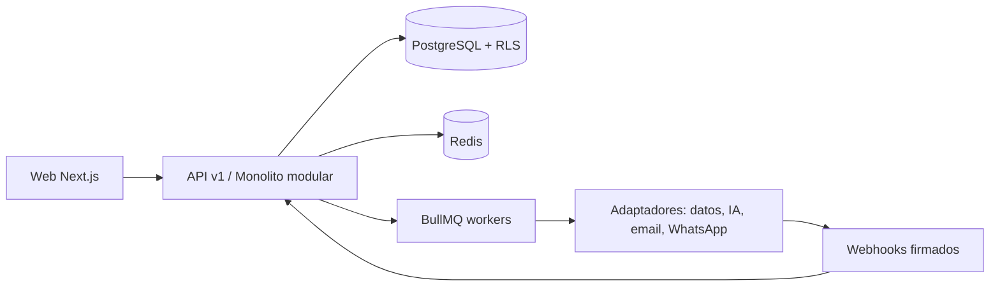

# Arquitectura del sistema

Bounded modules: identidad/tenant, catálogo, prospección, enriquecimiento, IA/scoring, campañas/canales, leads/CRM, cotizaciones, analítica y administración. Cada módulo expone servicios y eventos internos tipados; sólo contratos públicos cruzan límites. Lecturas analíticas pueden derivarse de eventos, sin sustituir el registro transaccional.
